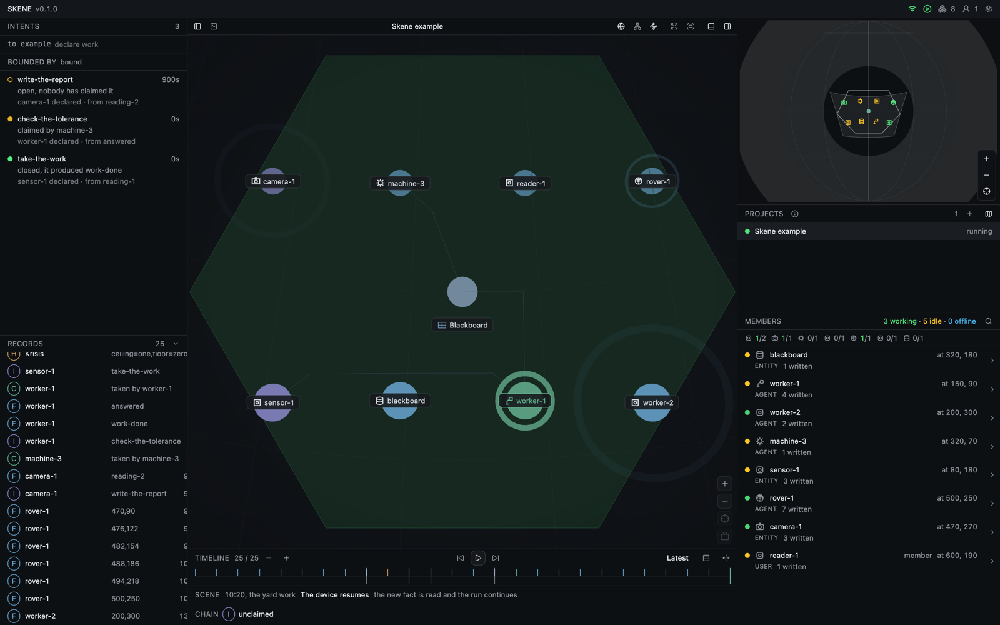

# Skene

A modular control pane over FIH state chains: one open surface where every fact, intent and hint is read from the
substrate's own record, in whichever perspective a project asks for.



## What it is

- **A data model.** The record is the substrate's, not a format invented for a screen: a fact is observed, an intent is declared over it, a hint bounds the judgement that took it. See [the record model](packages/kernel/src/types.ts).
- **A pane, not a product.** A deployment supplies a brand, a board and optionally a pack. The frame supplies the address, the record model, the panels, the transport and the host. See [the contract](packages/frame/src/index.ts).
- **A perspective is a package.** The cockpit, a map, footage and a graph are modules over the same record. A deployment imports the pictures it draws, and the import is what installs them.
- **The geometry is shared.** Everything that places a payload on the shell reads one projection, so two perspectives cannot disagree about where a thing stands. See [the board](packages/board/src/index.ts).

| The substrate | The record | The surface |
|:---|:---|:---|
| an observation projects a field | a **fact** | a row, a mark, a point |
| a field says what is admissible | a **hint** | what a member was not allowed to do |
| an act binds an observation to work | an **intent** | the chain, and the queue not yet taken |

## Packages

| Package | Holds | Depends on |
|:---|:---|:---|
| [kernel](packages/kernel/src/index.ts) | records, places, scenarios, campaigns, the pack rule. No React, no DOM, no renderer | none |
| [ui](packages/ui/src/index.ts) | primitives, chrome vocabulary, colour, the palette | kernel |
| [board](packages/board/src/index.ts) | bearings, the projection onto the shell, the patch a window covers, the disc, the glyphs | kernel, ui |
| [frame](packages/frame/src/index.ts) | the pane: window model, panels, registers, host, runtime | kernel, ui, board |
| [view-media](packages/view-media/src/index.ts) | footage: the picture, the surface it fills, the row mark, the surface control | frame, board |
| [view-map](packages/view-map/src/index.ts) | ground: the picture on the shell, the page toolbar, the place as a map | frame, board |
| [view-shell](packages/view-shell/src/index.ts) | the cockpit: the space on the shell, the windows on it, the wires control | frame, board |
| [view-graph](packages/view-graph/src/index.ts) | the run as a graph: nodes, edges, layout | frame |
| [examples/board](examples/board/src/main.tsx) | the smallest deployment: a brand, a board, one run | all of the above |

The frame ships no picture. A deployment with no footage carries neither a video element nor its sampler; one with no map carries no map library; one that opens on a table carries no three.js scene.

## Consuming

```bash
git clone --depth 1 https://github.com/ssccsorg/skene ../skene
```

| What you are building | Declare |
|:---|:---|
| any deployment | `@ssccsorg/skene-frame`, `@ssccsorg/skene-kernel`, `@ssccsorg/skene-ui`, `@ssccsorg/skene-board` |
| one that draws footage | `+ @ssccsorg/skene-view-media` |
| one that draws a map | `+ @ssccsorg/skene-view-map` |
| one that opens on the cockpit | `+ @ssccsorg/skene-view-shell` |
| one that draws the graph | `+ @ssccsorg/skene-view-graph` |

```json
"@ssccsorg/skene-frame": "file:../skene/packages/frame",
"@ssccsorg/skene-kernel": "file:../skene/packages/kernel",
"@ssccsorg/skene-ui": "file:../skene/packages/ui",
"@ssccsorg/skene-board": "file:../skene/packages/board"
```

The sibling packages are declared by the deployment because a package installed from a path resolves its siblings by the same path. A published release replaces these lines with version ranges.

```tsx
import '@ssccsorg/skene-view-shell';
import '@ssccsorg/skene-view-graph';
import { Frame } from '@ssccsorg/skene-frame';

createRoot(root).render(<Frame brand={brand} />);
```

| Setting | Why |
|:---|:---|
| `install-links=true` in `.npmrc` | installs the frame packed rather than linked: one React in the tree, no bundler symlink flag |
| a `@source` line per package in `styles.css` | Tailwind scans the package's classes beside the deployment's |
| `@import '@ssccsorg/skene-frame/tokens.css'` | the palette, with `--mark` and `--board` as the overridable tokens |

The packages publish TypeScript source, so a consumer's bundler compiles them. A build step comes with the first release consumed by something other than Vite.

## Extending

| What you add | Register | Lives in |
|:---|:---|:---|
| a reading, which is a whole perspective | `registerPack`, `registerReading` | [lib/readings.ts](packages/frame/src/lib/readings.ts) |
| a window kind, which is a picture on the shell | `registerViewKind` | [lib/view-kinds.ts](packages/frame/src/lib/view-kinds.ts) |
| a panel | `registerPanel` | [lib/panels.ts](packages/frame/src/lib/panels.ts) |
| a bar control | `registerInstrument` | [lib/instruments.ts](packages/frame/src/lib/instruments.ts) |
| a resource a project declares | `registerResource` | [lib/project.ts](packages/frame/src/lib/project.ts) |
| a host, which is the deployment's shell | `Host` | [lib/host.ts](packages/frame/src/lib/host.ts) |

A project names the readings it stands in its bundle, and the frame asks the register rather than keeping a list.

## Running

```bash
npm install
npm run dev          # http://localhost:5290
npm run build        # typecheck and a production bundle
```

The example is one project, one run, one place, and three chains in the three states a queue can be in. Its board names the reading it opens on and the deployment installs it; [pictures.test.ts](examples/board/tests/pictures.test.ts) holds the two together.

## Tests and CI

| Job | Holds |
|:---|:---|
| `package` matrix | one job a package: typecheck, then tests; `board` and `frame` also hold a coverage floor |
| `assembly` | every workspace resolves; the kernel imports nothing outside itself; the board imports no frame; the frame imports no view package |
| `example` | the deployment's own assertions, and a build that carries its board |

```bash
npm test                     # every package, in order
npm run test:coverage        # the two floors: board and frame
```

The workflow is [ci.yml](.github/workflows/ci.yml). There are no DOM tests: components are drawn by the example rather than asserted, and each floor is set where its tests reach.

## Status

- Version 0.1.0, consumed from a checkout by three deployments and the reference demonstration.
- The registers and the host are the stable API; everything else is exported for a deployment's tests and tools.
- What the frame remembers is kept under `skene.*`, through `storageName`, so two builds on one origin do not read each other's arrangement.

## Contributing

See [CONTRIBUTING.md](CONTRIBUTING.md). Security reports go to the address in [SECURITY.md](SECURITY.md).

## Licence

Apache-2.0. See [LICENSE](LICENSE).
